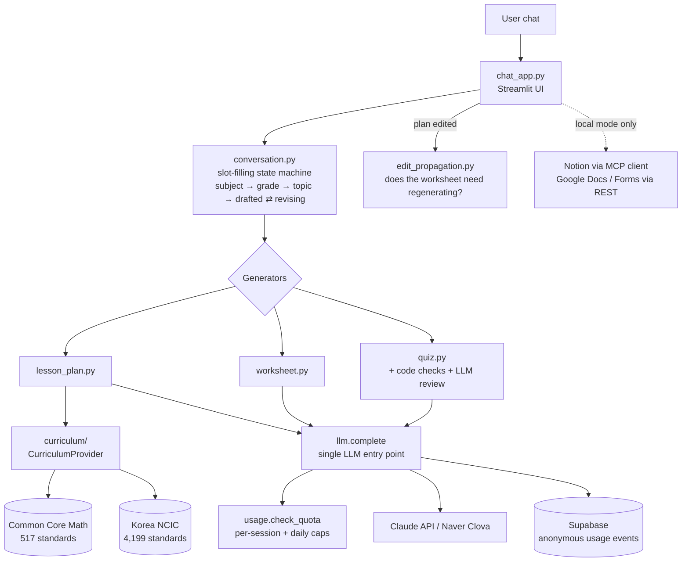

# class-prep-agent

**An AI agent that drafts curriculum-grounded lesson plans, student worksheets, and quizzes through a chat, and keeps them consistent as you revise.**

**Live demo:** https://class-prep-agent.streamlit.app (English · Common Core Math, no sign-up)

[한국어 README (full development log)](README.ko.md)

<!-- TODO: replace with a real screenshot or GIF of the deployed app -->
> 📸 _Screenshot / GIF of the live demo goes here._

---

## What it does

A teacher, TA, or tutor tells the agent a subject, grade, and topic in a chat. The agent then:

1. **Generates a discussion-based lesson plan** (8 sections: objectives, background reading, key concepts, discussion issues, lesson flow, sample worksheet, rubric) **citing matching curriculum standards** (Common Core Math, or Korea's 2022 national curriculum).
2. **Revises it from chat messages** ("make the lesson flow fit a 30-minute class").
3. **Builds a matching student worksheet**, and **regenerates it automatically when a plan edit affects it**, so the two documents stay consistent.
4. **Generates a 5-question multiple-choice quiz** with an answer key, checked by code and by a second LLM review pass.

Results can be downloaded (.md / .txt). Run locally with your own accounts, and the same flows also write to **Notion** (lesson plan), **Google Docs** (worksheet), and **Google Forms** (auto-graded quiz).

## Architecture



## Key design decisions

**One `CurriculumProvider` interface for two very different curricula.**
Korea's curriculum groups grades into bands ("grades 3–4" share standards); Common Core labels almost every grade separately. Instead of special-casing either, `grade_groups_for(grade)` returns "the labels this grade can appear under", which covers both shapes. The first implementation wrapped the existing Korean matcher unchanged (all existing tests still passed); the interface was only considered sufficient after a second, real implementation (Common Core Math) was added behind it. → [`src/curriculum/`](src/curriculum/)

**Edit propagation by field diff, not another LLM call.**
When a plan is revised, should the worksheet be regenerated? The worksheet prompt reads exactly five plan fields, so if none of them changed, regenerating cannot change the result. `worksheet_needs_update()` compares those fields: deterministic, free, and unit-testable, where an LLM classifier would cost a call and could answer inconsistently. → [`src/edit_propagation.py`](src/edit_propagation.py)

**A hand-written MCP client for Notion; REST for Google.**
`NotionMCPClient` talks to the official Notion MCP server over stdio using the Python `mcp` SDK. Working against the real server surfaced things the docs didn't mention: tool names carry an `API-` prefix, and validation errors come back inside a successful response (`isError` is not set), so the writer checks the response body too. Google Docs/Forms use the REST API instead: there is no Forms MCP server, and the Docs MCP preview had no create-document tool. → [`src/mcp_client.py`](src/mcp_client.py), [`src/notion_writer.py`](src/notion_writer.py)

**Every LLM call goes through one function.**
`llm.complete()` is the only path to a model. That made it possible to swap providers with one setting (Claude ↔ Naver Clova), and later to add cost caps and per-call token measurement for the public demo without touching any feature module. → [`src/llm.py`](src/llm.py)

**A public demo mode instead of public integrations.**
The Notion token and the Google OAuth token are both single-account credentials: exposed on a public URL, every visitor's output would land in the developer's own workspace and Drive. Making them multi-user needs per-user OAuth, so the demo ships the core value first (generation + chat revisions + downloads) and leaves the integrations to local use until users ask for them. → [`docs/deploy.md`](docs/deploy.md)

**Bounded cost on a personal API key.**
Per-session and global daily caps are checked inside `llm.complete()`. The daily count comes from the database, so a page refresh can't reset it. The API key's account has prepaid credit with auto-reload off, which caps the worst case. → [`src/usage.py`](src/usage.py)

**Anonymous usage metrics, private by construction.**
The logging function only accepts whitelisted event names; there is no parameter that could carry what a user typed. Session IDs are random UUIDs, the developer's own test sessions are flagged and excluded, and the app tells users what is collected. → [`src/usage.py`](src/usage.py)

## Lessons from the first real deployment

Switching the demo to a cheaper model (Claude Haiku 5.5) broke generation in ways the mocked test suite could not show. Each was diagnosed from the raw API response before being fixed:

| Symptom | Root cause | Fix |
|---|---|---|
| "Couldn't parse the lesson plan" | Thinking is on by default and spent the entire 2,000-token output budget (0 chars of text) | Thinking made configurable and disabled for this model; empty responses now report `stop_reason` |
| Still couldn't parse | The 8-section JSON itself was longer than 2,000 tokens (cut off in section 6) | Output limits raised for JSON-producing calls; truncation is logged |
| Fraction quizzes always rejected | The option checker evaluated "5/6" as a division, so legitimate "rewrite 1/2 as sixths" questions looked like duplicate answers | `a/b` treated as notation; answer uniqueness left to the LLM review pass |
| Quiz retry repeated the same mistake | The single retry resent the identical prompt | The retry prompt now includes the rejection reason |

## Run it locally

Requires Python 3.10+.

```bash
pip install -r requirements.txt
cp .env.example .env      # set ANTHROPIC_API_KEY (or LLM_PROVIDER=clova + HCX_API_KEY), DEMO_MODE=1
python -m streamlit run chat_app.py
```

- `DEMO_MODE=1` (or no `NOTION_API_KEY`) runs the **demo mode**: generate, revise, download, no external writes.
- `LOCALE=ko` switches the UI and the curriculum to Korean / NCIC (all subjects).
- The full Notion + Google Docs + Google Forms setup is described in [`README.ko.md`](README.ko.md) §7, §12, §17 (Korean).
- `app.py` is a separate tool: natural-language search and summarization over a Notion workspace via MCP.

**Tests:** `python -m pytest`. 257 tests run on mocked LLM calls and fake data (no API key, network, or credit needed), including a Streamlit `AppTest` that drives the full demo flow end to end.

## Project structure

```
chat_app.py              Streamlit UI: lesson plan / worksheet / quiz
app.py                   Notion search & summarize (MCP)
src/
  conversation.py        multi-turn slot-filling state machines
  lesson_plan.py         lesson plan generation (en + ko prompts)
  worksheet.py           student worksheet generation
  quiz.py                quiz generation, code checks, LLM review pass
  edit_propagation.py    plan → worksheet consistency
  curriculum/            CurriculumProvider + Common Core Math / NCIC
  llm.py                 single LLM entry point (Claude / Clova)
  usage.py               anonymous metrics + cost caps
  mcp_client.py          Notion MCP client (stdio)
  notion_writer.py, google_docs_writer.py, forms_writer.py
common_core_standards/   Common Core Math dataset (517) + license notice
ncic_standards/          Korea 2022 curriculum dataset (4,199), parsed from the official PDFs
docs/deploy.md           deployment runbook, metrics SQL
tests/
```

## Limitations

- The English mode covers Math only.
- The public demo does not write to Notion/Google; that needs per-user OAuth.
- Usage metrics count browser sessions, not people, and cannot measure return visits.
- A quiz revision that names a question by number ("make question 3 easier") can reorder questions instead of editing that one in place.

## Origin

Started as a solo project in a Korean NLP bootcamp (three staged assignments: Notion search via MCP → lesson plan chatbot → multi-activity agent), then extended with the US curriculum and the public deployment. The complete history, including every bug found along the way, is in [README.ko.md](README.ko.md).

Common Core State Standards © Copyright 2010. National Governors Association Center for Best Practices and Council of Chief State School Officers. All rights reserved.
